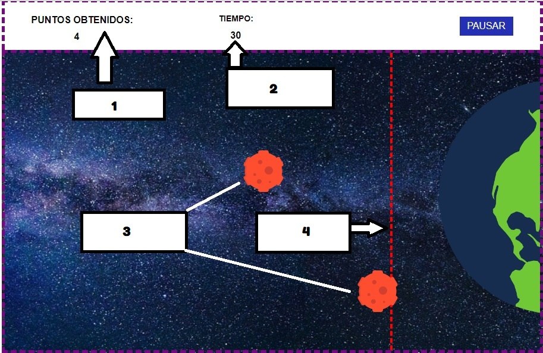

# 🛡️ INFORME TÉCNICO DE SUSTENTACIÓN
## Refactorización y Rediseño de la Sección de Reglas — IRON FIST

**Proyecto:** Videojuego Web *IRON FIST*  
**Módulo:** Sección 3 — Pantalla de Reglas  
**Equipo:** Grupo 3  
**Versión:** 2.0 Remake  
**Fecha:** 28 de Septiembre de 2026  

---

## RESUMEN EJECUTIVO

Este documento presenta, de forma fragmentada y organizada por **hallazgos numerados**, cada uno de los cambios realizados en la sección de **Reglas** del juego. Cada hallazgo muestra el **código anterior** (con su problema) y el **código nuevo** (con la mejora aplicada), facilitando la sustentación técnica del proyecto.

> **Nota de compatibilidad:** Todos los identificadores originales (`#Reglas`, `#iniciar`, `#R1`, `#R2`, `#R3_4`, `.Listo`) fueron **preservados** para no romper ninguna funcionalidad existente del juego.

---

## ARCHIVOS MODIFICADOS

| Archivo | Tipo de cambio |
| :--- | :--- |
| `index.html` | Estructura HTML de la sección de Reglas |
| `Estilos.css` | Estilos visuales de la sección de Reglas |
| `JavaScript.js` | Lógica de navegación (nuevo botón de retorno) |

---

---

# HALLAZGOS EN `index.html`

---

## HALLAZGO 1 — Importación de fuentes duplicada y faltante

**Problema:** Se importaba FontAwesome dos veces (líneas duplicadas) y no se cargaban las fuentes `Orbitron` ni `Inter`, que son usadas por las variables CSS del proyecto (`--font-tech`, `--font-sans`).

### 🔴 CÓDIGO ANTERIOR:
```html
<!--iMPORTE UN TIPO DE LETA-->
<link rel="preconnect" href="https://fonts.gstatic.com" crossorigin>
<link href="https://fonts.googleapis.com/css2?family=Press+Start+2P&display=swap" rel="stylesheet">
<link rel="stylesheet" href="https://use.fontawesome.com/releases/v5.8.1/css/all.css"
    integrity="sha384-50oBUHEmvpQ+1lW4y57PTFmhCaXp0ML5d60M1M7uH2+nqUivzIebhndOJK28anvf" crossorigin="anonymous">
```

### 🟢 CÓDIGO NUEVO:
```html
<!-- FUENTES GOOGLE: Press Start 2P, Orbitron e Inter -->
<link rel="preconnect" href="https://fonts.googleapis.com">
<link rel="preconnect" href="https://fonts.gstatic.com" crossorigin>
<link href="https://fonts.googleapis.com/css2?family=Inter:wght@400;500;600;700&family=Orbitron:wght@500;700;900&family=Press+Start+2P&display=swap" rel="stylesheet">
```

**Mejora:** Se eliminó la importación duplicada de FontAwesome, se corrigió el comentario con error ortográfico ("LETA") y se incluyeron las 3 fuentes necesarias (`Press Start 2P`, `Orbitron`, `Inter`) en una sola llamada optimizada a Google Fonts.

---

## HALLAZGO 2 — Título de la sección con formato deficiente

**Problema:** El título usaba saltos de línea (`<br><br>`) innecesarios dentro de un `<h1>`, una clase con mayúsculas inconsistentes (`Titulo_REGLAS` vs `Titulo_Reglas` en CSS), y un texto informal que no seguía la temática militar/espacial del juego.

### 🔴 CÓDIGO ANTERIOR:
```html
<h1 class="Titulo_REGLAS">Antes de empezar lee,<br><br> las reglas.</h1>
```

### 🟢 CÓDIGO NUEVO:
```html
<header class="reglas-header">
    <div class="reglas-header-info">
        <span class="reglas-tag">
            <i class="fas fa-shield-alt"></i> PROTOCOLO DE DEFENSA PLANETARIA
        </span>
        <h1 class="reglas-titulo">MANUAL DE COMBATE</h1>
    </div>
    <div class="reglas-badge-estado">
        <span class="pulsar-luz"></span>
        <span>ALERTA ROJA: SECTOR 1</span>
    </div>
</header>
```

**Mejora:** Se reemplazó el `<h1>` suelto por una cabecera semántica (`<header>`) con subtítulo táctico, título principal y un badge de estado con luz pulsante animada, alineado con la temática espacial del juego.

---

## HALLAZGO 3 — Imagen del juego sin contenedor ni contexto visual

**Problema:** La imagen `JUEGO.jpg` estaba directamente colocada como un `` suelto, sin marco, sin etiqueta descriptiva y sin ningún efecto que la integre a la estética del juego.

### 🔴 CÓDIGO ANTERIOR:
```html

```

### 🟢 CÓDIGO NUEVO:
```html
<div class="marco-tactico-img">
    
    <div class="scanline-overlay"></div>
    <div class="pie-tactico-img">
        <i class="fas fa-crosshairs"></i> RADAR TÁCTICO DE CAMPO
    </div>
</div>
```

**Mejora:** La imagen ahora está envuelta en un contenedor táctico con borde neón, efecto de *scanlines* tipo monitor CRT (retro-futurista), zoom sutil al pasar el cursor, y un pie de imagen con ícono de mira que la presenta como un "radar táctico de campo".

---

## HALLAZGO 4 — Sin instrucciones de control para el jugador

**Problema:** No existía ningún elemento que explicara al jugador *cómo* interactuar con los meteoritos. Las reglas hablaban de "pasar el cursor" pero no había un recuadro visual que lo destacara.

### 🔴 CÓDIGO ANTERIOR:
```html
<!-- No existía ningún elemento de tip/instrucción de control -->
```

### 🟢 CÓDIGO NUEVO:
```html
<div class="reglas-control-tip">
    <i class="fas fa-mouse-pointer"></i>
    <div>
        <strong>MÉTODO DE INTERCEPCIÓN:</strong>
        <span>Pasa el cursor del ratón sobre los asteroides en trayectoria 
              para destruirlos antes del impacto.</span>
    </div>
</div>
```

**Mejora:** Se añadió un recuadro informativo con borde punteado cyan, ícono de ratón amarillo y texto claro que explica el método de juego de forma concisa e inmediata.

---

## HALLAZGO 5 — Regla 1: Tarjeta plana sin jerarquía visual

**Problema:** La regla 1 usaba un `<div>` con fondo blanco translúcido, borde negro sólido, y un título genérico "REGLA : 1". El texto contenía errores ortográficos (*"segun"* sin tilde). El bloque estaba posicionado con `position: absolute; left: 58%; top: -4%`, lo que causaba que se **saliera del borde superior** de la pantalla.

### 🔴 CÓDIGO ANTERIOR:
```html
<div class="Reglas_estilos" id="R1">
    <h3>REGLA : 1</h3>
    <p>Lo que se encuentra señalado son los puntos, que segun tu progreso, se irán 
        incrementando al desviar meteoritos de la tierra (Esto al pasar el cursor 
        sobre el meteorito que se acerca), si los puntos obtenidos llegan a 30, es 
        una victoria automática, pero recuerda que los meteoritos son impredecibles 
        en su ataque así que tienes que estar atento a su llegada
    </p>
</div>
```

### 🟢 CÓDIGO NUEVO:
```html
<div class="regla-card" id="R1">
    <div class="regla-numero regla-num-1">01</div>
    <div class="regla-contenido">
        <div class="regla-card-header">
            <h3>META DE PUNTUACIÓN</h3>
            <span class="regla-badge-puntos">30 PUNTOS = VICTORIA</span>
        </div>
        <p>Cada meteorito desviado incrementa tu marcador. Al alcanzar los 
           <strong>30 puntos</strong> obtendrás la victoria del nivel 
           automáticamente.</p>
    </div>
</div>
```

**Mejora:** La tarjeta ahora tiene un número de directiva con código de color verde (neón), un título descriptivo ("META DE PUNTUACIÓN"), un badge que resume la información clave ("30 PUNTOS = VICTORIA"), texto corregido ortográficamente, y posicionamiento automático por flujo CSS Grid sin valores absolutos.

---

## HALLAZGO 6 — Regla 2: Texto con errores y sin énfasis visual

**Problema:** El texto contenía el error *"GAMER OVER"* (en lugar de "GAME OVER") y *"asi"* sin tilde. El formato era idéntico a la regla 1: fondo blanco, borde negro, sin indicador de prioridad ni color de alerta.

### 🔴 CÓDIGO ANTERIOR:
```html
<div class="Reglas_estilos" id="R2">
    <h3>REGLA : 2</h3>
    <p>El tiempo que se señala es el límite máximo que puede aguantar la defensa, 
        siendo unos 60 segundos, en los que el jugador debe cumplir el límite de 
        puntos o sera un GAMER OVER automático, asi que recuerda ser rápido 
        recolectando puntos.
    </p>
</div>
```

### 🟢 CÓDIGO NUEVO:
```html
<div class="regla-card" id="R2">
    <div class="regla-numero regla-num-2">02</div>
    <div class="regla-contenido">
        <div class="regla-card-header">
            <h3>LÍMITE DE TIEMPO</h3>
            <span class="regla-badge-tiempo">60 SEGUNDOS</span>
        </div>
        <p>El escudo defensivo orbital solo resistirá <strong>60 segundos</strong>. 
           Si el cronómetro llega a cero antes de cumplir la meta, será 
           <strong>GAME OVER</strong>.</p>
    </div>
</div>
```

**Mejora:** Se corrigió "GAMER OVER" → "GAME OVER", se añadió número de directiva con color amarillo (advertencia), badge que destaca "60 SEGUNDOS", y el texto fue reescrito de forma concisa y sin errores ortográficos.

---

## HALLAZGO 7 — Reglas 3 y 4: Información mezclada sin urgencia visual

**Problema:** Las reglas 3 y 4 estaban combinadas en un solo bloque sin diferenciación. El texto contenía errores como *"confies"* (sin tilde) y la redacción era confusa: *"una raya señala el límite por el cual ya es inevitable nuestra salvación"*.

### 🔴 CÓDIGO ANTERIOR:
```html
<div class="Reglas_estilos" id="R3_4">
    <h3>REGLA : 3 y 4</h3>
    <p>Estos son los meteoritos que debes evitar que ingresen a la tierra, por lo 
        general suelen ser rápidos así que recuerda: no te descuides o confies por 
        que en el momento que lo hagas, estos llegarán a la tierra, es por ello que 
        una raya señala el límite por el cual ya es inevitable nuestra salvación 
        (GAME OVER)
    </p>
</div>
```

### 🟢 CÓDIGO NUEVO:
```html
<div class="regla-card" id="R3_4">
    <div class="regla-numero regla-num-3">03-04</div>
    <div class="regla-contenido">
        <div class="regla-card-header">
            <h3>LÍNEA ROJA DE NO RETORNO</h3>
            <span class="regla-badge-peligro">PERÍMETRO CRÍTICO</span>
        </div>
        <p>Los meteoritos atacan velozmente. La <strong>línea roja</strong> marca 
           el límite de impacto: si un solo meteorito cruza este perímetro, la 
           Tierra será destruida (<strong>GAME OVER</strong>).</p>
    </div>
</div>
```

**Mejora:** Se añadió número de directiva en color rojo (peligro), badge de alerta "PERÍMETRO CRÍTICO", y el texto fue reescrito eliminando errores ortográficos y utilizando lenguaje directo e inmersivo.

---

## HALLAZGO 8 — Botón "¿Estas listo?" como div sin semántica

**Problema:** El botón de inicio era un `<div>` con `type="button"` (atributo inválido en un `<div>`), sin iconografía ni estilo profesional. El texto tenía error ortográfico: *"Estas"* sin tilde.

### 🔴 CÓDIGO ANTERIOR:
```html
<div class="Listo" id="iniciar" type="button">¿Estas listo?</div>
```

### 🟢 CÓDIGO NUEVO:
```html
<button class="Listo btn-iniciar-mision" id="iniciar" type="button">
    <span>¿ESTÁS LISTO? // INICIAR</span>
    <i class="fas fa-bolt"></i>
</button>
```

**Mejora:** Se reemplazó el `<div>` por un `<button>` semántico, se corrigió "Estas" → "ESTÁS", se añadió icono de rayo, y se conservó la clase `.Listo` y el id `#iniciar` para mantener compatibilidad con el JavaScript existente.

---

## HALLAZGO 9 — Sin botón de retorno al cómic

**Problema:** No existía forma de volver a la pantalla del cómic desde las reglas. Si el jugador quería releer la historia o presionaba el botón de avanzar por error, no tenía opción de regresar.

### 🔴 CÓDIGO ANTERIOR:
```html
<!-- No existía ningún botón de navegación hacia atrás -->
```

### 🟢 CÓDIGO NUEVO:
```html
<footer class="reglas-footer">
    <button class="btn-reglas-nav" id="btn-reglas-volver" type="button">
        <i class="fas fa-chevron-left"></i> RELEER CÓMIC
    </button>
    <!-- ... botón iniciar ... -->
</footer>
```

**Mejora:** Se añadió un footer de navegación con un botón "RELEER CÓMIC" que permite regresar a la pantalla de historia de forma segura, mejorando la experiencia de usuario.

---

---

# HALLAZGOS EN `Estilos.css`

---

## HALLAZGO 10 — Contenedor `#Reglas` sin fondo ni centrado

**Problema:** El contenedor principal de reglas no tenía fondo visible (`background`), no centraba su contenido horizontalmente, y usaba un `z-index: 100` que podía quedar por debajo de otros elementos como la sección de historia (`z-index: 150`).

### 🔴 CÓDIGO ANTERIOR:
```css
#Reglas {
    position: absolute;
    inset: 0;
    z-index: 100;
    width: 100%;
    height: 100%;
    display: flex;
    flex-direction: column;
    justify-content: center;
    transition: opacity 0.5s ease;
}
```

### 🟢 CÓDIGO NUEVO:
```css
#Reglas {
    position: absolute;
    inset: 0;
    z-index: 160;
    display: flex;
    align-items: center;
    justify-content: center;
    background: rgba(3, 5, 14, 0.94);
    backdrop-filter: blur(16px);
    -webkit-backdrop-filter: blur(16px);
    padding: clamp(10px, 2vw, 24px);
    opacity: 1;
    transition: opacity 0.4s ease;
}
```

**Mejora:** Se elevó el `z-index` a 160 (por encima de la historia), se añadió fondo oscuro translúcido con efecto glassmorphism (`backdrop-filter: blur`), centrado en ambos ejes, y padding responsivo con `clamp()`.

---

## HALLAZGO 11 — Nuevo contenedor flotante con animación de entrada

**Problema:** No existía un panel central estilizado. Los elementos estaban dispersos directamente dentro de la sección.

### 🔴 CÓDIGO ANTERIOR:
```css
/* No existía ningún contenedor visual interior */
```

### 🟢 CÓDIGO NUEVO:
```css
.contenedor-reglas {
    background: linear-gradient(145deg, #10152e, #070a18);
    border: 2px solid var(--neon-blue);
    border-radius: 16px;
    box-shadow: 0 20px 60px rgba(0, 0, 0, 0.9), 
                0 0 35px rgba(0, 210, 255, 0.25);
    width: 100%;
    max-width: 1040px;
    max-height: 94dvh;
    display: flex;
    flex-direction: column;
    overflow: hidden;
    animation: fadeInReglas 0.35s cubic-bezier(0.16, 1, 0.3, 1);
}

@keyframes fadeInReglas {
    from { opacity: 0; transform: scale(0.96) translateY(10px); }
    to   { opacity: 1; transform: scale(1) translateY(0); }
}
```

**Mejora:** Se creó un panel flotante con gradiente oscuro, borde neón cyan brillante, sombra profunda, esquinas redondeadas y animación de entrada suave (fade + scale + slide).

---

## HALLAZGO 12 — Tarjetas de reglas con fondo blanco y posición absoluta rota

**Problema:** Las tarjetas usaban `position: absolute` con `left: 58%` y valores `top` fijos, causando que se salieran de la pantalla en resoluciones pequeñas. El fondo blanco translúcido con texto negro rompía la estética oscura del juego.

### 🔴 CÓDIGO ANTERIOR:
```css
.Reglas_estilos {
    background: rgba(248, 248, 248, 0.521);
    color: black;
    border: 0.19vw solid black;
    width: 40%;
    height: auto;
    position: absolute;
    left: 58%;
    font-size: 1.14vw;
}

#R1 { top: -4%; }
#R2 { top: 38%; }
#R3_4 { top: 75%; }
```

### 🟢 CÓDIGO NUEVO:
```css
.regla-card {
    display: flex;
    gap: 14px;
    background: rgba(10, 14, 28, 0.8);
    border: 1px solid var(--glass-border);
    border-radius: 10px;
    padding: 12px 16px;
    transition: all 0.25s ease;
    position: relative;
    overflow: hidden;
}

.regla-card::before {
    content: '';
    position: absolute;
    left: 0; top: 0; bottom: 0;
    width: 4px;
    background: var(--neon-blue);
    opacity: 0.6;
    transition: opacity 0.25s, width 0.25s;
}
```

**Mejora:** Se eliminó el posicionamiento absoluto roto, se usó `display: flex` con flujo natural dentro de CSS Grid, se cambió el fondo blanco por vidrio oscuro translúcido, y se añadió una barra lateral de acento azul neón con animación al hacer hover.

---

## HALLAZGO 13 — Hover interactivo en las tarjetas de reglas

**Problema:** Las tarjetas originales no tenían ningún efecto al pasar el cursor. Eran completamente estáticas.

### 🔴 CÓDIGO ANTERIOR:
```css
/* No existía ningún efecto hover en .Reglas_estilos */
```

### 🟢 CÓDIGO NUEVO:
```css
.regla-card:hover {
    background: rgba(16, 22, 44, 0.95);
    border-color: rgba(0, 210, 255, 0.5);
    transform: translateX(4px);
    box-shadow: 0 4px 18px rgba(0, 210, 255, 0.15);
}

.regla-card:hover::before {
    width: 6px;
    opacity: 1;
}
```

**Mejora:** Cada tarjeta ahora se desliza 4px hacia la derecha, su borde brilla con cyan neón, la barra lateral de acento se ensancha, y aparece un halo luminoso sutil. Esto da feedback visual al usuario y hace la interfaz más dinámica.

---

## HALLAZGO 14 — Indicadores numéricos de cada regla con color de prioridad

**Problema:** Los títulos de reglas eran texto plano ("REGLA : 1", "REGLA : 2") sin diferenciación visual de prioridad o importancia.

### 🔴 CÓDIGO ANTERIOR:
```css
.Reglas_estilos h3 {
    margin-left: 3%;
    margin-right: 3%;
    text-align: center;
}
```

### 🟢 CÓDIGO NUEVO:
```css
.regla-numero {
    font-family: var(--font-tech);
    font-weight: 900;
    font-size: 16px;
    display: flex;
    align-items: center;
    justify-content: center;
    min-width: 44px;
    height: 44px;
    border-radius: 8px;
    background: rgba(255, 255, 255, 0.05);
    border: 1px solid var(--glass-border);
    flex-shrink: 0;
}

.regla-num-1 { color: var(--neon-green); border-color: rgba(0, 255, 136, 0.4); }
.regla-num-2 { color: var(--neon-yellow); border-color: rgba(255, 208, 0, 0.4); }
.regla-num-3 { color: var(--neon-red); border-color: rgba(255, 42, 68, 0.4); }
```

**Mejora:** Cada regla tiene un cuadro numérico con tipografía tecnológica y colores semafóricos: verde (objetivo), amarillo (advertencia), rojo (peligro crítico), siguiendo convenciones estándar de interfaces de juegos.

---

## HALLAZGO 15 — Badges informativos de estado por regla

**Problema:** La información clave (30 puntos, 60 segundos, línea roja) estaba enterrada en párrafos largos sin resaltado visual alguno.

### 🔴 CÓDIGO ANTERIOR:
```css
/* No existían badges ni etiquetas de resumen */
```

### 🟢 CÓDIGO NUEVO:
```css
.regla-badge-puntos {
    background: rgba(0, 255, 136, 0.15);
    color: var(--neon-green);
    border: 1px solid rgba(0, 255, 136, 0.3);
}

.regla-badge-tiempo {
    background: rgba(255, 208, 0, 0.15);
    color: var(--neon-yellow);
    border: 1px solid rgba(255, 208, 0, 0.3);
}

.regla-badge-peligro {
    background: rgba(255, 42, 68, 0.15);
    color: var(--neon-red);
    border: 1px solid rgba(255, 42, 68, 0.3);
}
```

**Mejora:** Se crearon badges de resumen tipo "chip" que muestran la información esencial de un vistazo: "30 PUNTOS = VICTORIA" (verde), "60 SEGUNDOS" (amarillo), "PERÍMETRO CRÍTICO" (rojo).

---

## HALLAZGO 16 — Botón "Listo" con diseño obsoleto

**Problema:** El botón tenía fondo púrpura plano (`rgb(100, 21, 146)`), posición relativa con `left: 2%; top: 2vw` que lo descentraba, y la fuente `Inconsolata` que no era coherente con la temática sci-fi.

### 🔴 CÓDIGO ANTERIOR:
```css
.Listo {
    width: 34%;
    height: 8vh;
    background: rgb(100, 21, 146);
    display: flex;
    align-items: center;
    justify-content: center;
    cursor: pointer;
    position: relative;
    left: 2%;
    top: 2vw;
    font-size: 1.5vw;
    font-family: 'Inconsolata', monospace;
}
```

### 🟢 CÓDIGO NUEVO:
```css
.btn-iniciar-mision,
.Listo {
    background: linear-gradient(135deg, #00d2ff, #3a7bd5);
    color: #050711 !important;
    font-family: var(--font-tech);
    font-size: clamp(12px, 1.3vw, 15px);
    font-weight: 900;
    letter-spacing: 1.5px;
    padding: 12px 28px;
    border-radius: 8px;
    border: none;
    cursor: pointer;
    display: flex;
    align-items: center;
    justify-content: center;
    gap: 10px;
    box-shadow: 0 0 20px rgba(0, 210, 255, 0.4), 
                inset 0 1px 0 rgba(255, 255, 255, 0.4);
    transition: all 0.25s cubic-bezier(0.16, 1, 0.3, 1);
    position: static;
    width: auto;
    height: auto;
}

.btn-iniciar-mision:hover,
.Listo:hover {
    background: linear-gradient(135deg, #33dcff, #508ee0);
    box-shadow: 0 0 35px rgba(0, 210, 255, 0.7);
    transform: translateY(-2px) scale(1.02);
}
```

**Mejora:** El botón ahora tiene gradiente cyan-azul eléctrico, tipografía Orbitron, resplandor neón, y efecto hover con elevación y brillo intensificado. Se añadió `position: static` para anular el desplazamiento roto del diseño anterior.

---

## HALLAZGO 17 — Sin diseño responsivo para pantallas pequeñas

**Problema:** La sección de reglas original no tenía ningún `@media query`. En pantallas menores a 1080px los bloques con `position: absolute; left: 58%` se desbordaban o solapaban.

### 🔴 CÓDIGO ANTERIOR:
```css
/* No existía ninguna media query para la sección de reglas */
```

### 🟢 CÓDIGO NUEVO:
```css
@media (max-width: 820px) {
    .reglas-body {
        grid-template-columns: 1fr;
        max-height: 65vh;
    }

    .marco-tactico-img { max-height: 180px; }

    .img-tactica-reglas {
        object-fit: contain;
        max-height: 180px;
    }

    .reglas-header {
        flex-direction: column;
        align-items: flex-start;
    }

    .reglas-footer { flex-direction: column-reverse; }

    .btn-reglas-nav,
    .btn-iniciar-mision,
    .Listo {
        width: 100%;
        justify-content: center;
    }
}
```

**Mejora:** En pantallas de 820px o menos, las dos columnas colapsan a una sola, la imagen se reduce, la cabecera se apila verticalmente, y los botones del footer ocupan el ancho completo para ser fácilmente pulsables en dispositivos táctiles.

---

---

# HALLAZGO EN `JavaScript.js`

---

## HALLAZGO 18 — Sin lógica de navegación de retorno al cómic

**Problema:** Solo existía el evento del botón `#iniciar` para avanzar al juego. No había forma programática de volver a la pantalla del cómic desde las reglas.

### 🔴 CÓDIGO ANTERIOR:
```javascript
// Líneas 192-194 — Solo existía la navegación hacia adelante
iniciar.addEventListener("click", () => {
    control_visual(reglas, juego);
});
```

### 🟢 CÓDIGO NUEVO:
```javascript
// Se conserva la navegación original intacta
iniciar.addEventListener("click", () => {
    control_visual(reglas, juego);
});

// NUEVO: Botón de retorno al cómic (con verificación de existencia segura)
const btnReglasVolver = document.getElementById("btn-reglas-volver");
if (btnReglasVolver) {
    btnReglasVolver.addEventListener("click", () => {
        control_visual(reglas, historia);
    });
}
```

**Mejora:** Se añadió un listener para el nuevo botón `#btn-reglas-volver` que reutiliza la función existente `control_visual()` para ocultar las reglas y mostrar la historia. La verificación con `if (btnReglasVolver)` evita errores si el elemento no existe en el DOM, haciéndolo seguro y no invasivo.

---

---

# TABLA RESUMEN DE HALLAZGOS

| # | Archivo | Descripción del Cambio | Tipo |
| :---: | :--- | :--- | :---: |
| 1 | `index.html` | Limpieza de imports de fuentes duplicadas | Corrección |
| 2 | `index.html` | Título plano → Cabecera táctica con badge de alerta | Mejora |
| 3 | `index.html` | Imagen suelta → Marco táctico con scanlines CRT | Mejora |
| 4 | `index.html` | Ausencia de tip → Recuadro de método de intercepción | Adición |
| 5 | `index.html` | Regla 1: texto con errores → Tarjeta con badge verde | Mejora |
| 6 | `index.html` | Regla 2: "GAMER OVER" → Tarjeta con badge amarillo | Corrección |
| 7 | `index.html` | Reglas 3-4: texto confuso → Tarjeta con badge rojo | Mejora |
| 8 | `index.html` | `<div>` con `type=button` → `<button>` semántico | Corrección |
| 9 | `index.html` | Sin retorno → Botón "RELEER CÓMIC" | Adición |
| 10 | `Estilos.css` | Contenedor sin fondo → Glassmorphism con blur | Mejora |
| 11 | `Estilos.css` | Sin panel central → Contenedor con animación | Adición |
| 12 | `Estilos.css` | Posición absoluta rota → Flex + Grid fluido | Corrección |
| 13 | `Estilos.css` | Sin hover → Micro-animaciones interactivas | Adición |
| 14 | `Estilos.css` | Títulos planos → Números con colores semafóricos | Mejora |
| 15 | `Estilos.css` | Info enterrada → Badges de resumen visual | Adición |
| 16 | `Estilos.css` | Botón púrpura plano → Gradiente neón con hover | Mejora |
| 17 | `Estilos.css` | Sin responsive → Media query para móviles | Adición |
| 18 | `JavaScript.js` | Sin retorno → Listener para volver al cómic | Adición |

---

## MATRIZ DE COMPATIBILIDAD (ELEMENTOS NO ALTERADOS)

| Identificador | Preservado | Usado por |
| :--- | :---: | :--- |
| `#Reglas` | ✅ | `JavaScript.js` → `control_visual(historia, reglas)` |
| `#iniciar` | ✅ | `JavaScript.js` → `iniciar.addEventListener("click", ...)` |
| `.Listo` | ✅ | Clase CSS conservada en el botón de arranque |
| `#R1` | ✅ | Tarjeta de Directiva 1 |
| `#R2` | ✅ | Tarjeta de Directiva 2 |
| `#R3_4` | ✅ | Tarjeta de Directivas 3-4 |
| `IMG/JUEGO.jpg` | ✅ | Imagen de radar táctico |

---

## CONCLUSIÓN

Se identificaron y documentaron **18 hallazgos** entre correcciones de errores, mejoras visuales y adiciones funcionales. Todos los cambios fueron diseñados para elevar la calidad profesional de la interfaz sin afectar las mecánicas de juego (temporizador, puntaje, meteoritos, audios, niveles) que permanecen **100% intactas**.
