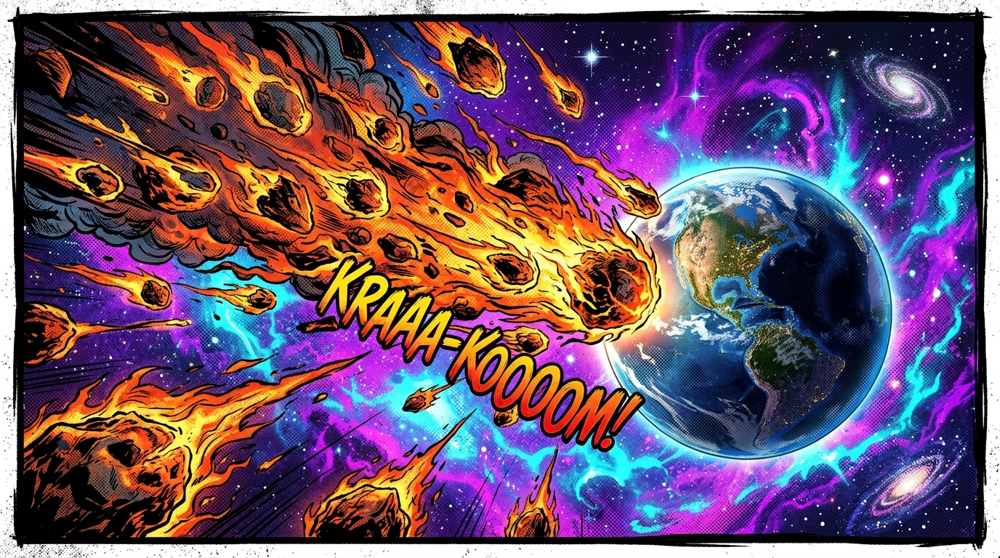
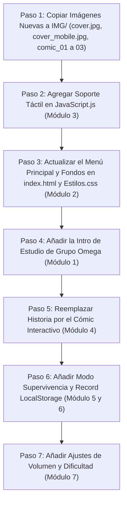

# 🛠️ GUÍA MAESTRA DE MIGRACIÓN: CÓMO INTEGRAR LAS MEJORAS DEL REMAKE EN EL JUEGO ORIGINAL

> **Propósito de esta guía:**  
> Esta guía ha sido creada especialmente para ti, para que puedas entender **exactamente qué archivos y qué líneas de código modificar en tu proyecto original** (`index.html`, `Estilos.css`, `JavaScript.js`, `Ejecucion2.js`, `Ejecucion3.js`), permitiéndote incorporar cada función del Remake V2 **a tu propio ritmo y a tu manera**.

---

## 📑 ÍNDICE DE MÓDULOS DE MEJORA

1. [Comparativa de Arquitectura: Original vs. Remake](#1-comparativa-de-arquitectura)
2. [Módulo 1: Intro Cinemática ("Grupo Omega Presenta...")](#2-módulo-1-intro-cinemática)
3. [Módulo 2: Menú Principal Compacto con Portada Adaptativa (PC y Móvil)](#3-módulo-2-menú-principal-compacto)
4. [Módulo 3: Soporte Táctil para Celulares y Detección de Swipe / Clic](#4-módulo-3-soporte-táctil-y-swipe)
5. [Módulo 4: Historia Tipo Cómic con Viñetas Narradas](#5-módulo-4-historia-tipo-cómic)
6. [Módulo 5: Modo Supervivencia Infinita con Guardado de Récord](#6-módulo-5-modo-supervivencia-infinita)
7. [Módulo 6: Barra de Láser Orbital y Botón de Habilidad](#7-módulo-6-barra-de-láser-orbital)
8. [Módulo 7: Panel de Ajustes (Volumen Maestro y 3 Dificultades)](#8-módulo-7-panel-de-ajustes)
9. [Módulo 8: Sistema de Audio Profesional (Web Audio API)](#9-módulo-8-sistema-de-audio-profesional)
10. [Módulo 9: Adaptación Vertical para Celulares (Planeta Abajo)](#10-módulo-9-adaptación-vertical-para-celulares)
11. [Hoja de Ruta Recomendada de Implementación](#11-hoja-de-ruta-recomendada)

---

## 1. COMPARATIVA DE ARQUITECTURA

| Aspecto | Juego Original (`PROYECTO IRON FIST/`) | Remake V2 (`iron fist remake v2/`) |
| :--- | :--- | :--- |
| **Renderizado** | Elementos HTML `<div>` con animaciones CSS `@keyframes`. | Canvas HTML5 a 60 FPS fluidos con partículas y efectos. |
| **Interacción** | Evento `mouseover` (solo ratón de PC, no táctil). | Eventos híbridos `pointerdown/pointermove` (Ratón + Pantalla táctil). |
| **Niveles** | 3 archivos separados (`JavaScript.js`, `Ejecucion2.js`, `Ejecucion3.js`). | 1 motor unificado orientado a objetos con control de estados. |
| **Sonido** | Elementos `<audio>` directos en HTML (pueden tener latencia o solaparse). | `Web Audio API` (sonidos sintetizados en tiempo real y volumen maestro). |
| **Móviles** | Orientado a pantallas horizontales fijas con desbordamiento. | Responsive total: horizontal en PC y vertical (planeta abajo) en celular. |

---

## 2. MÓDULO 1: INTRO CINEMÁTICA ("GRUPO OMEGA PRESENTA...")

### ¿Qué soluciona?
En el juego original entrabas directamente a una alerta intrusiva de SweetAlert (`Swal.fire`). La intro cinemática le da un aspecto de videojuego profesional con fundido negro (fade in / fade out).

### Paso 1: En tu `index.html` original
Busca la etiqueta `<body>` (aprox. línea 15) y justo al inicio de `<section id="Seccion_suprema">`, agrega esta sección:

```html
<!-- INTRO CINEMÁTICA DE ESTUDIO -->
<section id="screen-studio-intro">
    <div class="studio-logo-box">
        
        <h2 class="studio-title">GRUPO OMEGA</h2>
        <p class="studio-presenta">P R E S E N T A</p>
    </div>
    <button class="btn-skip-studio" id="btn-skip-studio">SALTAR INTRO &gt;&gt;</button>
</section>
```

*(Puedes copiar la imagen `logo_omega.png` desde `iron fist remake v2/img/logo_omega.png` a tu carpeta `IMG/`)*.

### Paso 2: En tu `Estilos.css` original
Agrega al final de tu archivo CSS:

```css
/* ==========================================================================
   INTRO CINEMÁTICA GRUPO OMEGA
   ========================================================================== */
#screen-studio-intro {
    position: fixed;
    inset: 0;
    z-index: 9999;
    background: #000000;
    display: flex;
    flex-direction: column;
    align-items: center;
    justify-content: center;
    gap: 20px;
    transition: opacity 0.8s ease, visibility 0.8s ease;
}

#screen-studio-intro.hidden {
    opacity: 0;
    pointer-events: none;
    visibility: hidden;
}

.studio-logo-box {
    display: flex;
    flex-direction: column;
    align-items: center;
    gap: 16px;
    animation: studioIntroAnim 3.8s cubic-bezier(0.16, 1, 0.3, 1) forwards;
}

@keyframes studioIntroAnim {
    0% { opacity: 0; transform: scale(0.85); filter: blur(8px); }
    20% { opacity: 1; transform: scale(1); filter: blur(0px); }
    75% { opacity: 1; transform: scale(1.04); filter: blur(0px); }
    100% { opacity: 0; transform: scale(1.1); filter: blur(6px); }
}

.studio-logo-img {
    width: 130px;
    height: auto;
    filter: drop-shadow(0 0 25px rgba(0, 210, 255, 0.7));
}

.studio-title {
    font-family: 'Press Start 2P', monospace;
    font-size: 22px;
    color: #ffffff;
    text-shadow: 0 0 20px #00d2ff;
    letter-spacing: 3px;
}

.studio-presenta {
    font-family: Arial, sans-serif;
    font-size: 14px;
    color: #ffd000;
    letter-spacing: 8px;
    text-transform: uppercase;
}

.btn-skip-studio {
    position: absolute;
    bottom: 24px;
    right: 24px;
    background: transparent;
    border: 1px solid rgba(255, 255, 255, 0.25);
    color: #94a3b8;
    font-size: 12px;
    padding: 6px 14px;
    border-radius: 6px;
    cursor: pointer;
}
.btn-skip-studio:hover {
    color: #fff;
    border-color: #fff;
}
```

### Paso 3: En tu `JavaScript.js` original
Al principio de tu `JavaScript.js`, agrega el temporizador para ocultar la intro:

```javascript
// Transición automática de la Intro de Estudio (3.8 segundos o al presionar Saltar)
const introTimer = setTimeout(Ocultar_Intro, 3800);

document.getElementById('btn-skip-studio').addEventListener('click', () => {
    clearTimeout(introTimer);
    Ocultar_Intro();
});

function Ocultar_Intro() {
    const intro = document.getElementById('screen-studio-intro');
    if (intro) intro.classList.add('hidden');
}
```

---

## 3. MÓDULO 2: MENÚ PRINCIPAL COMPACTO Y PORTADA ADAPTATIVA

### ¿Qué soluciona?
Tu menú original tenía textos como "IRON FIST" escrito dos veces (uno en HTML y otro en la imagen) y botones muy separados. En el Remake, la imagen ya trae el título 3D arriba y los botones son compactos.

### Paso 1: En tu `index.html` original
Reemplaza tu `<section class="Seccion_01" id="Seccion_01">` por un menú limpio:

```html
<section class="Seccion_01" id="Seccion_01">
    <!-- Espacio superior para que se vea el logo 3D de la imagen de fondo -->
    <div class="Espaciador_Logo"></div>

    <nav class="Contenedor_Botones_Menu">
        <button class="Boton_Menu" id="Btn_Historia" onclick="Iniciar_Historia()">
            <i class="fas fa-play"></i> MODO HISTORIA
        </button>
        <button class="Boton_Menu" id="Btn_Supervivencia" onclick="Iniciar_Supervivencia()">
            <i class="fas fa-infinity"></i> SUPERVIVENCIA
        </button>
        <button class="Boton_Menu" id="Btn_Comic" onclick="Abrir_Comic()">
            <i class="fas fa-book-open"></i> CÓMIC
        </button>
        <button class="Boton_Menu" id="Btn_Reglas" onclick="Mover()">
            <i class="fas fa-question-circle"></i> CÓMO JUGAR
        </button>
        <button class="Boton_Menu" id="Btn_Ajustes" onclick="Abrir_Ajustes()">
            <i class="fas fa-cog"></i> AJUSTES
        </button>
    </nav>

    <footer class="Pie_Menu">
        <div class="Pildora_Record">
            <i class="fas fa-trophy"></i> <span id="record-texto">RÉCORD: 0</span>
        </div>
        <span class="Version_Label">v2.0 &bull; Grupo Omega</span>
    </footer>
</section>
```

### Paso 2: En tu `Estilos.css` original
Agrega los estilos compactos y el cambio de portada para móviles:

```css
/* Portada 16:9 para PC */
.Seccion_01 {
    width: 100vw;
    height: 100vh;
    display: flex;
    flex-direction: column;
    align-items: center;
    justify-content: space-between;
    padding: 20px;
    background: url('IMG/cover.jpg') center center / cover no-repeat;
}

/* Portada vertical 9:16 automática para Celulares o Tablets verticales */
@media (orientation: portrait), (max-width: 600px) {
    .Seccion_01 {
        background-image: url('IMG/cover_mobile.jpg') !important;
    }
}

.Espaciador_Logo {
    min-height: 120px;
    width: 100%;
}

.Contenedor_Botones_Menu {
    display: flex;
    flex-direction: column;
    gap: 10px;
    width: 100%;
    max-width: 320px;
}

.Boton_Menu {
    background: rgba(8, 12, 28, 0.75);
    backdrop-filter: blur(10px);
    border: 1.5px solid rgba(0, 210, 255, 0.4);
    border-radius: 10px;
    padding: 10px 18px;
    color: #ffffff;
    font-family: 'Press Start 2P', monospace;
    font-size: 11px;
    cursor: pointer;
    display: flex;
    align-items: center;
    gap: 12px;
    transition: all 0.2s ease;
    box-shadow: 0 4px 15px rgba(0, 0, 0, 0.6);
}

.Boton_Menu:hover {
    transform: translateY(-2px);
    border-color: #00d2ff;
    box-shadow: 0 0 20px rgba(0, 210, 255, 0.5);
    background: rgba(14, 22, 50, 0.9);
}

.Pie_Menu {
    display: flex;
    justify-content: space-between;
    align-items: center;
    width: 100%;
    max-width: 420px;
}

.Pildora_Record {
    background: rgba(10, 15, 30, 0.7);
    border: 1px solid #ffd000;
    padding: 6px 14px;
    border-radius: 20px;
    font-size: 11px;
    color: #fff;
    font-family: Arial, sans-serif;
}
```

---

## 4. MÓDULO 3: SOPORTE TÁCTIL Y SWIPE / TAJO

### ¿Qué soluciona?
En tu código original tienes:
```javascript
document.getElementById("Meteiorito").addEventListener('mouseover', Aumentar_Puntos);
```
En celulares, **`mouseover` NO EXISTE**, porque los dedos no tienen cursor flotante. Si alguien toca la pantalla de un celular, el juego no responde.

### Solución en tu `JavaScript.js`, `Ejecucion2.js` y `Ejecucion3.js`:
Crea una función que registre tanto el toque como el arrastre táctil (`touchstart` / `touchmove` / `click`):

```javascript
// Función universal que soporta Mouse de PC y Dedo táctil de Móvil
function Asignar_Destruccion_Tactil(elementoId) {
    const el = document.getElementById(elementoId);
    if (!el) return;

    // 1. En PC: pasar el ratón por encima (como tu juego original)
    el.addEventListener('mouseover', Aumentar_Puntos);

    // 2. En Celulares: tocar el meteorito con el dedo
    el.addEventListener('touchstart', (e) => {
        e.preventDefault(); // Evita que la pantalla haga zoom accidental
        Aumentar_Puntos();
    }, { passive: false });

    // 3. En PC y Móvil: hacer clic directo
    el.addEventListener('click', Aumentar_Puntos);
}

// Aplicar a tus meteoritos en la función JUEGO():
Asignar_Destruccion_Tactil("Meteiorito");
Asignar_Destruccion_Tactil("Meteiorito2");
```

---

## 5. MÓDULO 4: HISTORIA TIPO CÓMIC

### ¿Qué soluciona?
En tu original, la sección `<section id="Seccion_2">` es solo un párrafo largo de texto plano que aburre al usuario. El formato cómic muestra 3 viñetas ilustradas narradas antes de jugar.

### Paso 1: En tu `index.html` original
Reemplaza `<section id="Seccion_2">` por este visualizador de cómic:

```html
<section id="Seccion_Comic" class="modal-comic-box hidden">
    <div class="comic-frame">
        <div class="comic-header">
            <span id="comic-capitulo-texto">CAPÍTULO I: EL DESCUBRIMIENTO (1/3)</span>
        </div>

        <div class="comic-body">
            
            <div class="comic-caption-box">
                <p id="comic-descripcion">Cargando...</p>
            </div>
        </div>

        <div class="comic-footer">
            <button class="btn-comic" id="btn-comic-ant" onclick="Cambiar_Vineta(-1)">
                <i class="fas fa-chevron-left"></i> Anterior
            </button>
            <button class="btn-comic" id="btn-comic-sig" onclick="Cambiar_Vineta(1)">
                Siguiente <i class="fas fa-chevron-right"></i>
            </button>
            <button class="btn-comic-jugar hidden" id="btn-comic-jugar" onclick="Empezar_Partida_Desde_Comic()">
                <i class="fas fa-gamepad"></i> ¡A DEFENDER EL PLANETA!
            </button>
        </div>
    </div>
</section>
```

### Paso 2: En tu `JavaScript.js` original
Agrega los datos de las viñetas y la lógica de cambio de viñeta:

```javascript
const VINETAS_COMIC = [
    {
        img: 'IMG/comic_01.jpg',
        capitulo: 'CAPÍTULO I: EL DESCUBRIMIENTO',
        texto: 'En cierto día, los telescopios del mundo detectaron una densa lluvia de meteoritos gigantescos en rumbo directo de colisión contra la Tierra.'
    },
    {
        img: 'IMG/comic_02.jpg',
        capitulo: 'CAPÍTULO I: LA ALERTA GLOBAL',
        texto: 'La alarma roja se desató: millones de ciudadanos exigieron respuestas mientras el cielo comenzaba a teñirse de fuego y escombros.'
    },
    {
        img: 'IMG/comic_03.jpg',
        capitulo: 'CAPÍTULO I: NUESTRA SALVACIÓN',
        texto: 'Los gobiernos activaron en secreto la iniciativa "IRON FIST": los proyectiles cinéticos más poderosos jamás construidos... ¡nuestra última esperanza!'
    }
];

let indiceVineta = 0;

function Abrir_Comic() {
    indiceVineta = 0;
    Actualizar_Vineta();
    document.getElementById('Seccion_Comic').classList.remove('hidden');
}

function Cambiar_Vineta(paso) {
    indiceVineta += paso;
    if (indiceVineta < 0) indiceVineta = 0;
    if (indiceVineta >= VINETAS_COMIC.length) indiceVineta = VINETAS_COMIC.length - 1;
    Actualizar_Vineta();
}

function Actualizar_Vineta() {
    const v = VINETAS_COMIC[indiceVineta];
    document.getElementById('comic-imagen').src = v.img;
    document.getElementById('comic-capitulo-texto').innerText = `${v.capitulo} (${indiceVineta + 1}/3)`;
    document.getElementById('comic-descripcion').innerText = v.texto;

    const btnAnt = document.getElementById('btn-comic-ant');
    const btnSig = document.getElementById('btn-comic-sig');
    const btnJugar = document.getElementById('btn-comic-jugar');

    btnAnt.style.display = indiceVineta === 0 ? 'none' : 'inline-block';

    if (indiceVineta === VINETAS_COMIC.length - 1) {
        btnSig.classList.add('hidden');
        btnJugar.classList.remove('hidden');
    } else {
        btnSig.classList.remove('hidden');
        btnJugar.classList.add('hidden');
    }
}

function Empezar_Partida_Desde_Comic() {
    document.getElementById('Seccion_Comic').classList.add('hidden');
    Mover_3(); // Ejecuta tu inicio original de partida
}
```

---

## 6. MÓDULO 5: MODO SUPERVIVENCIA INFINITA Y GUARDADO DE RÉCORD

### ¿Qué soluciona?
Tu juego original terminaba cuando llegabas a 27 puntos. El Modo Supervivencia no tiene límite: juegas hasta perder y guarda tu récord en el navegador con `localStorage`.

### En tu `JavaScript.js` original:
Agrega esta lógica de modo infinito:

```javascript
let EsModoSupervivencia = false;
let RecordMeteoritos = parseInt(localStorage.getItem('iron_fist_record')) || 0;

// Actualizar el récord en pantalla al cargar
document.getElementById('record-texto').innerText = `RÉCORD: ${RecordMeteoritos}`;

function Iniciar_Supervivencia() {
    EsModoSupervivencia = true;
    Puntaje = 0;
    Tiempo = 9999; // Tiempo infinito

    // Ocultar menú y mostrar juego
    document.getElementById("Seccion_01").style.display = "none";
    document.getElementById("Seccion_Juego").style.display = "block";

    // Mostrar barra y botón de láser
    document.getElementById('hud-laser-box').style.display = 'block';
    document.getElementById('btn-laser-flotante').style.display = 'block';

    JUEGO();
}

// Al perder (GameOver):
function Al_Perder_Juego() {
    if (EsModoSupervivencia) {
        if (Puntaje > RecordMeteoritos) {
            RecordMeteoritos = Puntaje;
            localStorage.setItem('iron_fist_record', RecordMeteoritos);
            alert(`¡NUEVO RÉCORD ALCANZADO! Destruiste ${RecordMeteoritos} meteoritos.`);
        } else {
            alert(`Sobreviviste destruyendo ${Puntaje} meteoritos. Tu récord es ${RecordMeteoritos}.`);
        }
        document.getElementById('record-texto').innerText = `RÉCORD: ${RecordMeteoritos}`;
    } else {
        alert("Lo lamento, perdiste.");
    }
}
```

---

## 7. MÓDULO 6: BARRA DE LÁSER ORBITAL EXCLUSIVO DE SUPERVIVENCIA

### ¿Qué soluciona?
El usuario no quería que el láser apareciera en el Modo Historia ni que el planeta disparase solo. Solo debe cargarse al destruir meteoritos en Supervivencia y activarse mediante un botón.

### Paso 1: En tu `index.html` original (dentro de la cabecera del juego)
```html
<!-- Barra de Láser en el HUD (oculta por defecto en Historia) -->
<div id="hud-laser-box" style="display: none;">
    <span>LÁSER: <b id="laser-porcentaje">0%</b></span>
    <div style="width: 100px; height: 10px; background: #1e293b; border-radius: 5px;">
        <div id="laser-relleno" style="width: 0%; height: 100%; background: #00d2ff; border-radius: 5px;"></div>
    </div>
</div>

<!-- Botón de Habilidad flotante (esquina inferior derecha) -->
<button id="btn-laser-flotante" style="display: none;" disabled onclick="Disparar_Hiper_Laser()">
    ⚡ LÁSER ORBITAL (0%)
</button>
```

### Paso 2: En tu `JavaScript.js` original
```javascript
let CargaLaser = 0;

// Dentro de tu función Aumentar_Puntos():
function Aumentar_Puntos() {
    Puntaje++;
    
    // Solo carga láser en Modo Supervivencia:
    if (EsModoSupervivencia) {
        CargaLaser = Math.min(100, CargaLaser + 10);
        document.getElementById('laser-porcentaje').innerText = `${CargaLaser}%`;
        document.getElementById('laser-relleno').style.width = `${CargaLaser}%`;

        const btnLaser = document.getElementById('btn-laser-flotante');
        if (CargaLaser >= 100) {
            btnLaser.disabled = false;
            btnLaser.innerText = '⚡ ¡DISPARAR LÁSER LISTO!';
            btnLaser.style.background = '#00d2ff';
            btnLaser.style.color = '#000';
        } else {
            btnLaser.disabled = true;
            btnLaser.innerText = `⚡ LÁSER (${CargaLaser}%)`;
        }
    }
}

// Al presionar el botón de disparo:
function Disparar_Hiper_Laser() {
    if (CargaLaser < 100) return;
    CargaLaser = 0;

    // Sonido de rayo si tienes Web Audio API o play de audio
    document.getElementById('laser-porcentaje').innerText = '0%';
    document.getElementById('laser-relleno').style.width = '0%';
    document.getElementById('btn-laser-flotante').disabled = true;

    // Destruye todos los meteoritos visibles en pantalla al instante
    Puntaje += 5; // Puntos extra
    alert("⚡ ¡RAYO LÁSER ORBITAL DISPARADO! Pantalla despejada.");
}
```

---

## 8. MÓDULO 7: PANEL DE AJUSTES (VOLUMEN Y 3 NIVELES DE DIFICULTAD)

### ¿Qué soluciona?
Permite al jugador ajustar el volumen global y seleccionar entre **Fácil, Normal y Difícil**, aumentando la velocidad y la cantidad de meteoritos requeridos para ganar.

### Paso 1: En tu `index.html` original
Agrega la ventana modal de ajustes:

```html
<section id="Modal_Ajustes" class="modal-ajustes hidden">
    <div class="ajustes-card">
        <h2><i class="fas fa-cog"></i> AJUSTES</h2>

        <div class="ajuste-fila">
            <label>VOLUMEN: <span id="vol-texto">70%</span></label>
            <input type="range" id="vol-slider" min="0" max="100" value="70" oninput="Cambiar_Volumen(this.value)">
        </div>

        <div class="ajuste-fila">
            <label>DIFICULTAD:</label>
            <div class="botones-dificultad">
                <button class="btn-diff active" id="diff-facil" onclick="Cambiar_Dificultad('FACIL')">FÁCIL</button>
                <button class="btn-diff" id="diff-normal" onclick="Cambiar_Dificultad('NORMAL')">NORMAL</button>
                <button class="btn-diff" id="diff-dificil" onclick="Cambiar_Dificultad('DIFICIL')">DIFICIL</button>
            </div>
            <p id="diff-info">Fácil: 15 / 25 / 40 meteoritos. Velocidad normal.</p>
        </div>

        <button onclick="Cerrar_Ajustes()" class="btn-guardar">GUARDAR Y VOLVER</button>
    </div>
</section>
```

### Paso 2: En tu `JavaScript.js` original
```javascript
let Dificultad = localStorage.getItem('iron_fist_diff') || 'FACIL';
let MetaMeteoritosNivel1 = 15;

function Cambiar_Dificultad(nivel) {
    Dificultad = nivel;
    localStorage.setItem('iron_fist_diff', nivel);

    document.querySelectorAll('.btn-diff').forEach(b => b.classList.remove('active'));
    document.getElementById(`diff-${nivel.toLowerCase()}`).classList.add('active');

    const info = document.getElementById('diff-info');
    if (nivel === 'FACIL') {
        MetaMeteoritosNivel1 = 15;
        info.innerText = 'Fácil: 15 / 25 / 40 meteoritos. Velocidad normal.';
    } else if (nivel === 'NORMAL') {
        MetaMeteoritosNivel1 = 25;
        info.innerText = 'Normal: 25 / 35 / 55 meteoritos. Velocidad +25%.';
    } else if (nivel === 'DIFICIL') {
        MetaMeteoritosNivel1 = 35;
        info.innerText = 'Difícil: 35 / 50 / 75 meteoritos. Lluvia veloz.';
    }
}

function Cambiar_Volumen(valor) {
    document.getElementById('vol-texto').innerText = `${valor}%`;
    const factor = valor / 100;
    
    // Aplicar a tus pistas de audio originales:
    const musicas = ['narracion', 'Perdiste_sound', 'ganaste'];
    musicas.forEach(id => {
        const audio = document.getElementById(id);
        if (audio) audio.volume = factor;
    });
}

function Abrir_Ajustes() {
    document.getElementById('Modal_Ajustes').classList.remove('hidden');
}

function Cerrar_Ajustes() {
    document.getElementById('Modal_Ajustes').classList.add('hidden');
}
```

---

## 9. MÓDULO 8: INTEGRAR EL MOTOR DE AUDIO (`audio.js`)

En el Remake creamos un archivo completo llamado `audio.js` que no requiere instalar nada; funciona directamente con el sintetizador nativo de Google Chrome / Edge / Safari.

### ¿Cómo agregarlo a tu juego original?
1. Copia el archivo `iron fist remake v2/audio.js` a tu carpeta original (`c:\Users\Gamers\Desktop\PRUEBAS\PROYECTO IRON FIST\audio.js`).
2. En tu `index.html` original, antes de cerrar `</body>`:
   ```html
   <script src="audio.js"></script>
   <script src="JavaScript.js"></script>
   ```
3. Ahora en tu `JavaScript.js` puedes hacer sonar efectos épicos instantáneos sin recargar archivos MP3:
   - Al cortar/pasar el dedo: `window.audioV2.playPlasmaSlash();`
   - Al golpear con fuerza: `window.audioV2.playHeavyPunch();`
   - Al disparar el rayo: `window.audioV2.playMegaLaserBeam();`

---

## 10. MÓDULO 9: ADAPTACIÓN VERTICAL PARA CELULARES (PLANETA ABAJO)

### ¿Cómo funciona la física adaptativa?
En computadoras, el juego funciona de izquierda a derecha (el planeta está a la derecha). En celulares, los dedos juegan mucho mejor con el **planeta en la parte inferior** y los meteoritos cayendo de arriba hacia abajo.

### En tu `Estilos.css` original:
Usa `@media (orientation: portrait)` para rotar los ejes en celulares:

```css
@media (orientation: portrait) {
    /* Mover el planeta a la parte inferior de la pantalla */
    .Planeta_tierra, #Planeta {
        position: absolute !important;
        bottom: -50px !important;
        left: 50% !important;
        transform: translateX(-50%) !important;
        top: auto !important;
        right: auto !important;
        width: 180px !important;
        height: 180px !important;
    }

    /* La línea de defensa pasa de ser vertical a ser horizontal */
    .Raya_defensa, #Raya {
        position: absolute !important;
        bottom: 120px !important;
        left: 0 !important;
        width: 100vw !important;
        height: 3px !important;
        top: auto !important;
        border-top: 2px dashed #00d2ff !important;
        border-right: none !important;
    }

    /* Los meteoritos caen desde la parte superior (Y = 0 hacia abajo) */
    @keyframes Caida_Meteorito_Vertical {
        0% { top: -60px; }
        100% { top: 80vh; }
    }
}
```

---

## 11. HOJA DE RUTA RECOMENDADA

Para actualizar tu juego original sin romper lo que ya funciona, sigue este orden:



---
*Guía elaborada para el equipo de desarrollo de IRON FIST - Versión 2.0 &bull; Grupo Omega.*
